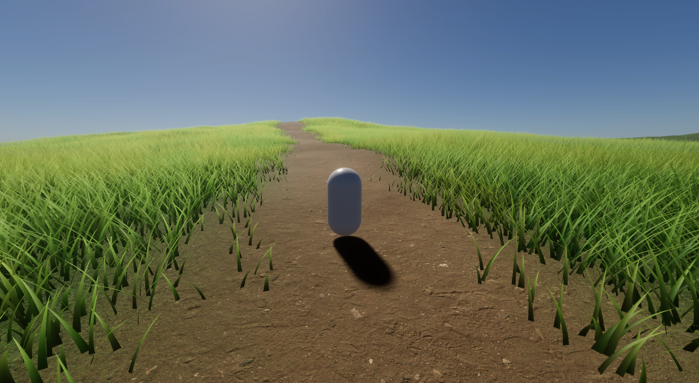
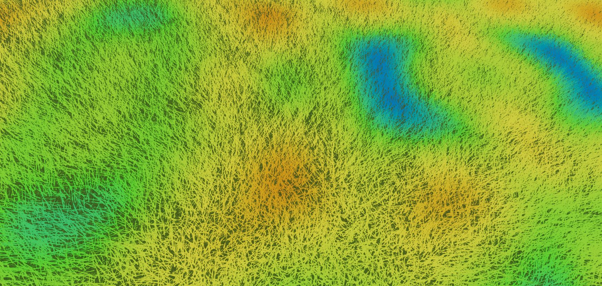

# Unity Grass Rendering

A real-time, GPU-driven procedural grass renderer for Unity 6 and the High Definition Render Pipeline (HDRP). It adapts the system Sucker Punch Productions presented for *Ghost of Tsushima* (Wohllaib, GDC 2021): every blade is a cubic Bézier curve generated on the GPU each frame, culled and level-of-detail-selected in a compute shader, and drawn with indirect draw calls, with no data read back to the CPU.

The project was developed as an undergraduate thesis (TCC), *Renderização Procedural de Grama em Tempo Real na Unity*.



## Features

- World split into 10 m tiles, culled by bounding box on the CPU and per blade on the GPU (frustum, terrain mask, distance and density).
- One compute shader dispatch per frame fills two append buffers, one per level of detail, and two indirect draw calls render them.
- Cubic Bézier blades with independent height, tilt, side tilt, bend and width, plus rounded normals and view-space thickening.
- Voronoi clumps that share facing direction, color tint and height falloff.
- Wind driven by a tileable Perlin noise texture scrolled in world space.
- Custom forward lighting: wrapped diffuse, Blinn-Phong, fake translucency and fake ambient occlusion, converging to the terrain's shading at a distance to reduce shimmering.
- Geometric LOD (15 vertices down to a single triangle), continuous density LOD, height fade and far-shading fade.
- Grass placement and slope lean driven by the native Unity `Terrain` and its painted layers.
- Buffers sized from the current settings instead of the worst case.

## Requirements

- Unity **6000.5.6f1** (Unity 6.5)
- HDRP **17.5.0** (installed through the Package Manager, already listed in `Packages/manifest.json`)
- A GPU and graphics API with compute shader and indirect draw support. Developed and tested on Windows with Direct3D 12.

## Getting started

1. Clone the repository:
   ```
   git clone https://github.com/andrewmvk/unity-grass-rendering.git
   ```
2. Open the folder with Unity Hub using the editor version above. The first import takes a few minutes while the `Library` folder is generated.
3. Open `Assets/OutdoorsScene.unity` and press Play.

### Controls

| Action | Input |
|---|---|
| Move | `W` `A` `S` `D` or gamepad left stick |
| Jump | `Space` or gamepad south button |
| Look around | Mouse or gamepad right stick |

The bindings come from `Assets/InputSystem_Actions.inputactions`.

## Configuration

Select the object with the `GrassManager` component in the scene. The main settings are:

| Group | Setting | Description |
|---|---|---|
| Grid Streaming | `grassPerAxisPerTile` | Blades per axis in each tile (16 means 256 blades per tile). |
| Grid Streaming | `renderDistanceInTiles` | Render radius, in tiles. |
| Geometric LOD | `lodSwitchDistance` | Distance at which blades change from the full mesh to a single triangle. |
| Density LOD | `densityFadeStartDistance`, `minDensityFraction` | Where blades start being thinned out and the fraction kept at the edge. Setting the fraction to 1 disables density LOD. |
| Terrain | `terrain`, `slopeLeanStrength` | Terrain the blades grow on (required) and how much they lean downhill. |
| Clumping | `clumpSize`, `clumpColorA`, `clumpColorB`, ... | Size, color and shape of the Voronoi clumps. |
| Wind | `windDirectionDegrees`, `windSpeed`, `windGustSize`, ... | Direction, speed and size of the wind gusts. |
| Blade Shape | `bladeHeight`, `bladeWidth`, ... | Base values for the shape of each blade. |

Each field has a tooltip in the Inspector. The two debug toggles, `debugClumpView` and `debugWindView`, show the raw clump colors and the wind noise. The image below is the wind view, where blue is calm and red is a strong gust.



## Project structure

```
Assets/
  OutdoorsScene.unity          Demo scene with a painted terrain
  Scripts/
    GrassManager.cs            Tile streaming, buffers, compute dispatch and indirect draws
    Player.cs                  Simple character controller for the demo scene
  Shaders/
    Compute/                   Blade generation (GrassBuilder.compute), hashing and Voronoi clumps
    GrassBladeSpine.hlsl       Bézier curve, blade mesh and normals
    GrassVertex.hlsl           Vertex stage, wind, view-space thickening and far shading
    GrassTerrainSampling.hlsl  Terrain height, normal and layer mask sampling
    GrassStructs.hlsl          Shared data layouts
    DummyGrass.shader          Forward shader used by the grass materials
  Settings/                    HDRP assets and sky settings
```

## How it works

Every frame, `GrassManager` selects the tiles that intersect the camera frustum and dispatches one compute shader for all of them. Each thread generates one blade, discards it if it fails any of the culling tests, and appends the survivors to the high-detail or low-detail buffer. The append counters are copied to indirect argument buffers on the GPU, and `Graphics.DrawProceduralIndirect` draws each buffer with its own material. The vertex shader only evaluates the Bézier curve, so all per-blade work happens once, in the compute shader.

## References

- Eric Wohllaib. *Procedural Grass in Ghost of Tsushima*. Game Developers Conference, 2021.
- Garrett Gunnell (Acerola). [Grass](https://github.com/GarrettGunnell/Grass), 2021.
- SimonDev. [Quick_Grass](https://github.com/simondevyoutube/Quick_Grass), 2023.

No code from these projects was copied. They were studied for the techniques they implement.

## License

Released under the [MIT License](LICENSE).
